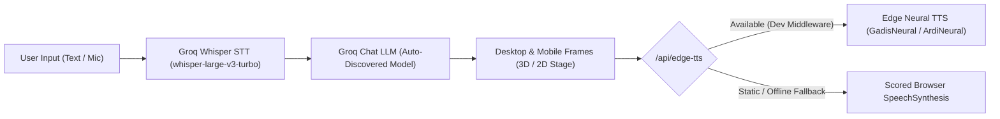

# Shi'ar — Interactive 3D & 2D Islamic Character Studio

**Shi'ar** (*Syi'ar Islam + Web3D*) is an interactive web studio for presenting Islamic educational messages (*syi'ar*), daily du'a, adab reminders, and greetings through expressive **3D and 2D chibi characters** (**Aisyah** and **Ahmad**) inside responsive **Desktop** and **Mobile** device frames.

Designed for creators, educators, and video producers, Shi'ar combines a real-time **Three.js / React Three Fiber** stage, **Groq AI** (Whisper STT + LLM), and **Microsoft Edge Neural TTS** (`id-ID-GadisNeural` & `id-ID-ArdiNeural`) for natural, human-sounding Indonesian voice output at zero TTS cost.

---

## Key Features

### 1. Dual-Dimension Character Showcase (3D & 2D)
- **3D Collectible Islamic Diorama (`DioramaCharacter3D.tsx`):** Displays high-resolution character artwork inside a real-time WebGL stage with an octagonal emerald-and-gold pedestal, sculpted beveled **Crescent Moon (Hilal)**, orbiting **5-point & 8-point (*Rub el Hizb*) Islamic stars**, dynamic shadows, and `OrbitControls`.
- **Custom `.GLB` / `.GLTF` Model Loader (`GlbCharacterModel.tsx`):** Upload any 3D `.glb` model directly from the header (`Load GLB`) with automatic bounding-box normalization, sRGB texture calibration, studio IBL reflections (`<Environment>` + `<Lightformer>`), and embedded animation playback (`idle`, `salam`, `wave`).
- **2.5D Interactive Sprite Stage (`Character2DStage.tsx`):** Renders transparent PNG character sprites with cursor-driven 3D CSS parallax tilt, breathing idle motion, and pose transitions.

### 2. Auto-Detected Desktop & Mobile Frames + Fullscreen Recording
- **Automatic Viewport & Device Detection (`useAutoFrame.ts`):** Defaults to `Auto`, automatically selecting the **Desktop Frame** on wide screens and the **Mobile Frame** on narrow/mobile viewports, with one-click manual overrides for `Desktop`, `Mobile`, or side-by-side `Both`.
- **Dedicated Fullscreen Recording Mode:** Both `DesktopFrame` (16:9 widescreen) and `MobileFrame` (9:16 portrait smartphone shell with Dynamic Island) include a **Fullscreen** toggle using the Browser Fullscreen API for clean screen recording on either platform.

### 3. Smart Shi'ar AI & Humanized Neural Voice Stack
- **100% Free Natural Voice Output (`edgeTtsService.ts` + Vite `/api/edge-tts`):**
  - **Aisyah (Women):** `id-ID-GadisNeural`
  - **Ahmad (Men):** `id-ID-ArdiNeural`
  - Streams crisp MP3 audio via `python -m edge_tts` in development, with automatic fallback to a scored browser Web Speech API selector (`voiceEngine.ts`) when deployed statically.
- **Groq Speech-to-Text (`whisper-large-v3-turbo`):** Speak in Indonesian via the microphone button in `SmartShiarBar` to generate a matching Shi'ar card.
- **Groq Smart Shi'ar LLM (`groqShiarService.ts`):** Automatically discovers active chat models via `GET /openai/v1/models` and generates structured Arabic + Indonesian Shi'ar cards (calligraphy, title, translation, and reflection).

---

## System Architecture



---

## Tech Stack

| Layer | Technology |
| :--- | :--- |
| **Framework** | React 18, TypeScript 5.6, Vite 6 |
| **Styling** | Tailwind CSS v4 (`@tailwindcss/vite`), Lucide Icons |
| **3D Engine** | Three.js, `@react-three/fiber`, `@react-three/drei` |
| **AI (STT & LLM)** | Groq OpenAI-Compatible API (`whisper-large-v3-turbo`, `/chat/completions`, `/models`) |
| **Neural TTS** | Python `edge-tts` (`id-ID-GadisNeural`, `id-ID-ArdiNeural`) + Web Speech API fallback |

---

## Local Development Setup

### Prerequisites
- **Node.js** `v20+` (verified on `v22.22.0`) and **npm** `v10+`
- **Python** `3.10+` (for local Edge Neural TTS audio synthesis)

### 1. Clone & Install Dependencies
```bash
git clone <your-repo-url>
cd shi-ar
npm install
```

### 2. Install Edge TTS (For Humanized Indonesian Voice)
```bash
pip install edge-tts
```
> Verify installation with `python -m edge_tts --version`.

### 3. Configure Groq API Key (Optional, for Smart Shi'ar AI & Whisper Mic)
You can provide your Groq API key (`gsk_...`) in either of two ways:
- **Via `.env` / `.env.local`** (copy `.env.example`):
  ```env
  VITE_GROQ_API_KEY=gsk_your_api_key_here
  ```
  *(Both `VITE_GROQ_API_KEY` and `GROQ_API_KEY` are supported by `vite.config.ts`.)*
- **Via UI:** Click **Groq Key** in the top studio header and paste your key (stored locally in `localStorage`).

### 4. Start the Development Server
```bash
npm run dev
```
Open the local URL printed by Vite (typically `http://localhost:5173`).

---

## Project Structure

```text
shi-ar/
├── public/
│   └── assets/
│       └── characters/
│           ├── ahmad-2d.png          # Transparent 2D character sprite (Ahmad)
│           └── aisyah-2d.png         # Transparent 2D character sprite (Aisyah)
├── src/
│   ├── components/
│   │   ├── character/
│   │   │   └── Character2DStage.tsx  # 2.5D parallax & breathing sprite stage
│   │   ├── frames/
│   │   │   ├── DesktopFrame.tsx      # Desktop browser mockup + fullscreen mode
│   │   │   └── MobileFrame.tsx       # 9:16 smartphone mockup + fullscreen mode
│   │   ├── three/
│   │   │   ├── CharacterStage3D.tsx  # R3F Canvas, ACES Filmic tone mapping & IBL
│   │   │   ├── ChibiCharacter3D.tsx  # Procedural toon-shaded chibi fallback
│   │   │   ├── DioramaCharacter3D.tsx# Collectible 3D diorama with pedestal & stars
│   │   │   ├── GlbCharacterModel.tsx # Auto-normalized .GLB/.GLTF loader
│   │   │   └── IslamicCelestial3D.tsx# Beveled 3D Crescent Moon & Islamic stars
│   │   └── ui/
│   │       ├── GroqKeyModal.tsx      # LocalStorage Groq API key modal
│   │       ├── SmartShiarBar.tsx     # Prompt & Whisper STT bar
│   │       └── StudioHeader.tsx      # Minimalist studio control header
│   ├── data/
│   │   └── shiarContent.ts           # Character profiles & curated Shi'ar messages
│   ├── hooks/
│   │   └── useAutoFrame.ts           # Real-time desktop/mobile frame detection
│   ├── services/
│   │   ├── edgeTtsService.ts         # /api/edge-tts client + browser fallback
│   │   └── groqShiarService.ts       # Groq LLM, Whisper STT & model discovery
│   ├── utils/
│   │   └── voiceEngine.ts            # Scored gender-aware Web Speech fallback
│   ├── App.tsx
│   ├── index.css
│   ├── main.tsx
│   └── vite-env.d.ts
├── .env.example
├── .gitignore
├── index.html
├── package.json
├── tsconfig.json
└── vite.config.ts                    # Includes /api/edge-tts dev middleware
```

---

## Using Custom `.GLB` 3D Character Models

To display full 360-degree volumetric 3D models matching your 2D character designs:
1. Upload `public/assets/characters/aisyah-2d.png` or `ahmad-2d.png` to an Image-to-3D tool such as **Tripo3D**, **Hyper3D Rodin**, or **Meshy**.
2. Export the model as a Draco-compressed **`.glb`** with PBR textures (recommended < 3 MB, ~20k–35k triangles).
3. Click **Load GLB** in the Studio Header and select your `.glb` file to preview it immediately inside both the Desktop and Mobile frames.

---

## Build & Deployment

```bash
npm run build
npm run preview
```

- **Static Hosting (Vercel / Netlify / GitHub Pages):** The frontend builds cleanly into `dist/`. Note that `/api/edge-tts` runs inside Vite's Node dev server middleware (`configureServer`). On static hosts without a Python/Node backend, TTS automatically falls back to the scored browser Web Speech API (`voiceEngine.ts`). For production Edge TTS, deploy `/api/edge-tts` as a small Python/FastAPI or Node microservice.

---

## License

See [LICENSE](LICENSE) for full license details.
